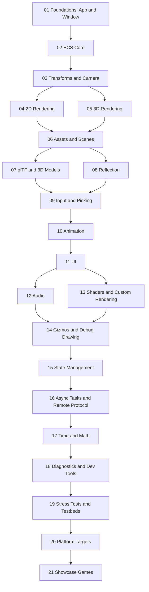

# Bevy Capabilities Map

A mental map of what Bevy can do, built from the engine's own `examples/` tree (330+ examples across ~30 folders, surveyed from a local checkout of `bevyengine/bevy` at `v0.20.0`, sibling to the `game` project at `~/Projects/bevy`).

The notes below are ordered the way a real Bevy project actually grows — not alphabetically, not by the engine's own folder names. Start at the top, follow **"Leads to"** links downward for the main path, and branch sideways on **"Related"** links when a side-quest becomes relevant (physics-ish movement, custom shaders, networking tools...).

Each note lists a handful of representative examples (path relative to `bevy/examples/`) rather than the full list — the goal is a map, not an index.

## The growth path

## Stage by stage

1. [[01 Foundations - App and Window]] — boot an `App`, open a window, understand plugins
2. [[02 ECS Core]] — entities, components, systems, schedules: the vocabulary everything else uses
3. [[03 Transforms and Camera]] — position things in space, look at them
4. [[04 2D Rendering]] — sprites, 2D meshes, bloom, text2d
5. [[05 3D Rendering]] — PBR materials, lighting, shadows, post-processing
6. [[06 Assets and Scenes]] — load/hot-reload files, save/load whole worlds
7. [[07 glTF and 3D Models]] — bring in real 3D assets made in Blender etc.
8. [[08 Reflection]] — runtime type introspection that scene serialization quietly depends on
9. [[09 Input and Picking]] — keyboard/mouse/gamepad/touch, and clicking on things in the world
10. [[10 Animation]] — skeletal animation, tweening, animation graphs
11. [[11 UI]] — menus, HUDs, widgets, text layout
12. [[12 Audio]] — sound effects, music, spatial audio
13. [[13 Shaders and Custom Rendering]] — outgrow the built-in materials
14. [[14 Gizmos and Debug Drawing]] — see what your code is actually doing
15. [[15 State Management]] — organize the app into Menu/Playing/Paused states
16. [[16 Async Tasks and Remote Protocol]] — background work, and controlling a running app from outside
17. [[17 Time and Math]] — the cross-cutting toolbox (timers, curves, bounding volumes)
18. [[18 Diagnostics and Dev Tools]] — FPS counters, custom diagnostics, editor-ish overlays
19. [[19 Stress Tests and Testbeds]] — "does this still run at 10,000 entities"
20. [[20 Platform Targets]] — wasm, mobile, no_std
21. [[21 Showcase Games]] — full demos that tie everything above together

## How this maps onto `game`

The `game` project (`~/Projects/game`, Bevy 0.19.1) currently sits around stage 6–9: it has ECS basics ([[02 ECS Core]] — `Person`/`Name` components, `update_people`/`greet_people` systems), a minimal 3D scene ([[05 3D Rendering]] — `PointLight`, `Camera3d`, `Mesh3d`/`MeshMaterial3d`), scene loading from a `.scn.ron` file via `DynamicWorldRoot` ([[06 Assets and Scenes]]), and camera panning via `leafwing-input-manager`'s `ActionState`/`InputMap` ([[09 Input and Picking]]). Untouched so far: animation, UI, audio, shaders, state management.
