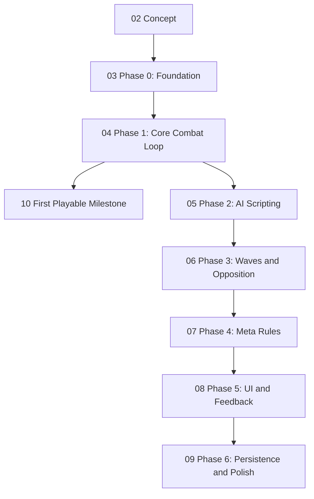

# Game Roadmap

A map of what `game` needs to become, in the order it needs to be built — structured the same way as [[00 Bevy Capabilities Map]] in the `Bevy` folder: a graph of the growth path, then a stage-by-stage list of links to the actual articles, then a grounding section tying it back to the real repo.

## The build order

`01 Cleanup Backlog` isn't in this diagram on purpose — it's mechanical, genre-independent work that can be done in any order, in parallel with everything above. Good for a low-focus session: see the note itself.

## Stage by stage

1. [[02 Concept]] — what the game actually is: scriptable units instead of towers, plus the sub-decisions still open (scripting language, roster size, single-player scope)
2. [[03 Phase 0 - Foundation]] — core data model, terrain, asset loading, level loading: no gameplay yet, just the substrate
3. [[04 Phase 1 - Core Combat Loop]] — stats, pathing, attacks, damage — hardcoded, so the combat feel can be validated before scripting is built on top of it
4. [[10 First Playable Milestone]] — the concrete end-of-Phase-1 target: one level, one wave, hardcoded "attack nearest enemy" AI
5. [[05 Phase 2 - AI Scripting]] — the differentiator: sandboxed scripting runtime, the sensor/action API, the in-game script editor, script persistence
6. [[06 Phase 3 - Waves and Opposition]] — fixed enemy AI and the wave/spawn system
7. [[07 Phase 4 - Meta Rules]] — win/lose objectives and scoring
8. [[08 Phase 5 - UI and Feedback]] — the rest of the UI (HUD, selection, win/lose screens) and input system extensions
9. [[09 Phase 6 - Persistence and Polish]] — save/load game state, animation, audio, VFX

Side track, anytime: [[01 Cleanup Backlog]].

## Architecture convention

Decided 2026-10-14: `src/systems/` is split into one subdirectory per plugin — each subdir's `mod.rs` defines a `Plugin` that registers every system living in that subdir, and `main.rs` only ever adds plugins, never individual systems. Three subdirs exist now: `systems/core/` (`CorePlugin`), `systems/terrain/` (`TerrainPlugin`), and `systems/character_controller/` (`CharacterControllerPlugin`). As phases get built, expect one subdir per phase (e.g. `systems/combat/` → `CombatPlugin` for [[04 Phase 1 - Core Combat Loop]], `systems/ai_scripting/` → `AiScriptingPlugin` for [[05 Phase 2 - AI Scripting]]) rather than everything piling into `core`.

## Current state of the repo

Snapshot as of 2026-10-16. This section tracks shape, not file/line detail, on purpose — [[01 Cleanup Backlog]] is the ground truth for known-rough edges and gets updated the moment one is resolved, so re-describing that detail here just gives it a second place to go stale.

The project is still at the start of [[04 Phase 1 - Core Combat Loop]], not yet past engine/physics scaffolding — Phase 0's core data model (`Unit`/`Enemy`/`Team`) and Phase 1's stats/damage/pathing systems don't exist yet.

- **Plugin wiring** — `main.rs` adds `DefaultPlugins`, `CorePlugin`, `TerrainPlugin`, `CharacterControllerPlugin`, in that order.
- **`CorePlugin`** (`systems/core/`) — registers `InputManagerPlugin<CameraMovement>`/`InputManagerPlugin<PlayerAction>`, loads key bindings from `assets/button_config.ron` at `Startup` (a fallible system — a missing/malformed config file halts startup with a specific error instead of a generic panic), and logs `PlayerAction::Confirm`/`Pause` on `Update` (no real behavior wired to either yet — `Pause` is waiting on [[08 Phase 5 - UI and Feedback]]).
- **`TerrainPlugin`** (`systems/terrain/`) — registers `avian3d`'s `PhysicsPlugins` and spawns a 28×16 grid of glTF floor tiles, one flat static collider spanning the whole grid (no per-tile colliders yet — terrain has no height variation to need them), and a directional light.
- **`CharacterControllerPlugin`** (`systems/character_controller/`) — the current collision/animation testbed. Spawns a physics-driven player capsule (`avian3d` `RigidBody`/`Collider`/`LinearVelocity`) controlled by `CharacterMovement` actions (WASD + Space), a third-person orbit camera driven by `CameraMovement::Pan`, and a `Fox.glb` visual (spawned as a child once its glTF scene loads async) with an Idle/Walking/Jumping animation state machine. Known-rough edges here (velocity-heuristic ground check, no real jump clip, fox-as-placeholder-humanoid) are tracked in [[01 Cleanup Backlog]], not repeated here.
- **Tooling** — nightly Rust + cranelift dev codegen (`Cargo.toml`), a `headless_screenshot` feature/bin for smoke-testing rendering without a display.

The input-pattern/two-camera inconsistencies this section used to describe (a leftover raw-`KeyCode` system, Bevy's built-in `FreeCamera`, an inactive leafwing camera kept alive only as a query-matching stopgap) are gone — resolved 2026-10-15, see [[01 Cleanup Backlog]]. `leafwing-input-manager` actions are now the only input pattern in the codebase.
