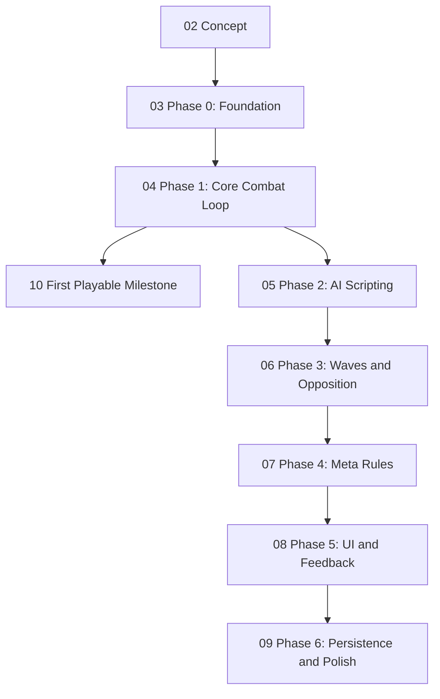

# Game Roadmap

A map of what `game` needs to become, in the order it needs to be built — structured the same way as [[00 Bevy Capabilities Map]] in the `Bevy` folder: a graph of the growth path, then a stage-by-stage list of links to the actual articles, then a grounding section tying it back to the real repo.

## The build order

`01 Cleanup Backlog` isn't in this diagram on purpose — it's mechanical, genre-independent work that can be done in any order, in parallel with everything above. Good for a low-focus session: see the note itself.

## Stage by stage

1. [[02 Concept]] — what the game actually is: scriptable units instead of towers, plus the sub-decisions still open (scripting language, roster size, single-player scope)
2. [[03 Phase 0 - Foundation]] — core data model, terrain, asset loading, level loading: no gameplay yet, just the substrate
3. [[04 Phase 1 - Core Combat Loop]] — stats, pathing, attacks, damage — hardcoded, so the combat feel can be validated before scripting is built on top of it
4. [[10 First Playable Milestone]] — the concrete end-of-Phase-1 target: one level, one wave, hardcoded "attack nearest enemy" AI
5. [[05 Phase 2 - AI Scripting]] — the differentiator: sandboxed scripting runtime, the sensor/action API, the in-game script editor, script persistence
6. [[06 Phase 3 - Waves and Opposition]] — fixed enemy AI and the wave/spawn system
7. [[07 Phase 4 - Meta Rules]] — win/lose objectives and scoring
8. [[08 Phase 5 - UI and Feedback]] — the rest of the UI (HUD, selection, win/lose screens) and input system extensions
9. [[09 Phase 6 - Persistence and Polish]] — save/load game state, animation, audio, VFX

Side track, anytime: [[01 Cleanup Backlog]].

## Current state of the repo

Snapshot of `~/Projects/game` as of 2026-10-14, grounded in the actual source — the project is still at the very start of [[03 Phase 0 - Foundation]] / early [[04 Phase 1 - Core Combat Loop]], not yet past engine scaffolding:

- **Plugin wiring** — `main.rs:7-28`. `HelloPlugin` registers `keyboard_input_system`, `pan_camera`, `materialize_shapes`, `player_action_system` on `Update`, and `scene.spawn()`, `setup`, `load_button_config` on `Startup`. The original Bevy tutorial systems (`add_people`, `greet_people`, `update_people`) are wired up but commented out (`main.rs:19-22`).
- **Input** — two input patterns coexist right now:
  - The intended one: `leafwing-input-manager` actions. `CameraMovement::Pan` drives `pan_camera` (`systems/input.rs:22-37`, mouse-move dual-axis). `PlayerAction::Confirm`/`Pause` are loaded from `assets/button_config.ron` via `load_button_config` (`systems/button_config.rs:68-90`) and merely logged by `player_action_system` (`systems/input.rs:13-20`) — no real behavior yet.
  - The leftover one: `keyboard_input_system` (`systems/input.rs:39-84`) reads `ButtonInput<KeyCode>` directly for A/D camera rotation. Predates the action-based convention — flagged in [[01 Cleanup Backlog]].
- **Scene** — `setup()` (`systems/scene.rs:36-86`) hardcodes a `PointLight` and `Camera3d`, and spawns a `DynamicWorldRoot` loaded from `assets/load_scene_example.scn.ron`. `materialize_shapes` (`systems/scene.rs:88-111`) turns `SpawnFloor`/`SpawnCube` placeholder components into real meshes once loaded. A parallel, entirely commented-out `scene()` function (`systems/scene.rs:8-34`) is dead code.
- **Dead tutorial code** — `components/mod.rs` still defines `Person`/`Name`/`GreetTimer`, and `systems/people.rs` still has `add_people`/`greet_people`/`update_people` plus a passing unit test. Not wired into `main.rs` anymore.
- **Tooling** — nightly Rust + cranelift dev codegen (`Cargo.toml`), a `headless_screenshot` feature/bin for smoke-testing rendering without a display.

None of Phase 0's core data model, Phase 1's stats/attack/damage systems, or anything past it exists yet — the engine scaffolding above is what [[03 Phase 0 - Foundation]] and [[04 Phase 1 - Core Combat Loop]] replace and build on.
