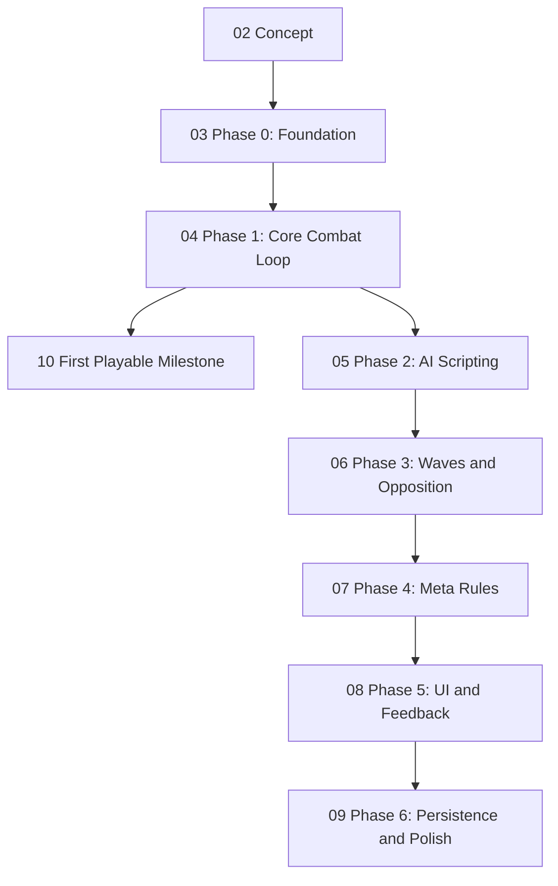

# Game Roadmap

A map of what `game` needs to become, in the order it needs to be built — structured the same way as [[00 Bevy Capabilities Map]] in the `Bevy` folder: a graph of the growth path, then a stage-by-stage list of links to the actual articles, then a grounding section tying it back to the real repo.

## The build order

`01 Cleanup Backlog` isn't in this diagram on purpose — it's mechanical, genre-independent work that can be done in any order, in parallel with everything above. Good for a low-focus session: see the note itself.

## Stage by stage

1. [[02 Concept]] — what the game actually is: scriptable units instead of towers, plus the sub-decisions still open (scripting language, roster size, single-player scope)
2. [[03 Phase 0 - Foundation]] — core data model, terrain, asset loading, level loading: no gameplay yet, just the substrate
3. [[04 Phase 1 - Core Combat Loop]] — stats, pathing, attacks, damage — hardcoded, so the combat feel can be validated before scripting is built on top of it
4. [[10 First Playable Milestone]] — the concrete end-of-Phase-1 target: one level, one wave, hardcoded "attack nearest enemy" AI
5. [[05 Phase 2 - AI Scripting]] — the differentiator: sandboxed scripting runtime, the sensor/action API, the in-game script editor, script persistence
6. [[06 Phase 3 - Waves and Opposition]] — fixed enemy AI and the wave/spawn system
7. [[07 Phase 4 - Meta Rules]] — win/lose objectives and scoring
8. [[08 Phase 5 - UI and Feedback]] — the rest of the UI (HUD, selection, win/lose screens) and input system extensions
9. [[09 Phase 6 - Persistence and Polish]] — save/load game state, animation, audio, VFX

Side track, anytime: [[01 Cleanup Backlog]].

## Architecture convention

Decided 2026-10-14: `src/systems/` is split into one subdirectory per plugin — each subdir's `mod.rs` defines a `Plugin` that registers every system living in that subdir, and `main.rs` only ever adds plugins, never individual systems. So far there's a single subdir, `systems/core/`, with `CorePlugin`. As phases get built, expect one subdir per phase (e.g. `systems/combat/` → `CombatPlugin` for [[04 Phase 1 - Core Combat Loop]], `systems/ai_scripting/` → `AiScriptingPlugin` for [[05 Phase 2 - AI Scripting]]) rather than everything piling into `core`.

## Current state of the repo

Snapshot of `~/Projects/game` as of 2026-10-14, grounded in the actual source — the project is still at the very start of [[03 Phase 0 - Foundation]] / early [[04 Phase 1 - Core Combat Loop]], not yet past engine scaffolding:

- **Plugin wiring** — `main.rs` adds `DefaultPlugins`, `CorePlugin`, and `TerrainPlugin`. `CorePlugin` (`systems/core/mod.rs`) registers `InputManagerPlugin<CameraMovement>`/`InputManagerPlugin<PlayerAction>`, `keyboard_input_system`, `pan_camera`, `materialize_shapes`, `player_action_system` on `Update`, and `setup`/`load_button_config` on `Startup`. `TerrainPlugin` (`systems/terrain/mod.rs`) registers Bevy's built-in `FreeCameraPlugin` and a `spawn_terrain` system on `Startup`.
- **Input** — two input patterns coexist right now:
  - The intended one: `leafwing-input-manager` actions. `CameraMovement::Pan` drives `pan_camera` (`systems/core/input.rs:22-37`, mouse-move dual-axis). `PlayerAction::Confirm`/`Pause` are loaded from `assets/button_config.ron` via `load_button_config` (`systems/core/button_config.rs:68-90`) and merely logged by `player_action_system` (`systems/core/input.rs:13-20`) — no real behavior yet.
  - The leftover one: `keyboard_input_system` (`systems/core/input.rs:39-84`) reads `ButtonInput<KeyCode>` directly for A/D camera rotation. Predates the action-based convention — flagged in [[01 Cleanup Backlog]].
  - Bevy's own `FreeCamera` component (`systems/terrain/mod.rs`) is a third pattern, orthogonal to the two above — WASD + mouse-look, not leafwing-driven. First real exercise of Phase 0's "terrain" and "loading game assets" items.
- **Scene** — `core::scene::setup()` (`systems/core/scene.rs`) spawns a `PointLight` and a `Camera3d` with a leafwing `InputMap`, but that camera's `Camera.is_active` is now `false` — `terrain::spawn_terrain`'s `FreeCamera` is the one actually rendering. The inactive camera is kept alive only so `pan_camera`'s `Single<...>` query still matches exactly one entity instead of panicking; this is a deliberate stopgap, not a design decision. `materialize_shapes` (`systems/core/scene.rs`) still turns `SpawnFloor`/`SpawnCube` placeholders from the RON scene into real meshes.
- **Terrain** — `terrain::spawn_terrain` (`systems/terrain/mod.rs`) loads one glTF floor tile (`assets/models/terrain/ground_tile.glb`, copied from a local Bevy examples checkout's `alien_cake_addict` showcase — first real on-disk 3D asset in the repo, as opposed to procedural `Cuboid`/`Circle` meshes) and instances it across a 28×16 grid via `WorldAssetRoot`/`GltfAssetLabel`, each tile its own entity at an integer `(i, 0, j)` transform. Deliberately rectangular (not square) and grid-addressable — a later collision/placement system can key off `(i, j)` directly instead of doing general-purpose spatial queries. Alongside a `DirectionalLight` sun and the active `FreeCamera`.
- **Tooling** — nightly Rust + cranelift dev codegen (`Cargo.toml`), a `headless_screenshot` feature/bin for smoke-testing rendering without a display.

Two cameras existing at once (one inactive) is exactly the kind of thing flagged for a later refactor rather than fixed now — see [[01 Cleanup Backlog]]. Beyond that, Phase 0's core data model, Phase 1's stats/attack/damage systems, and anything past it still don't exist — the engine scaffolding above is what [[03 Phase 0 - Foundation]] and [[04 Phase 1 - Core Combat Loop]] replace and build on.
