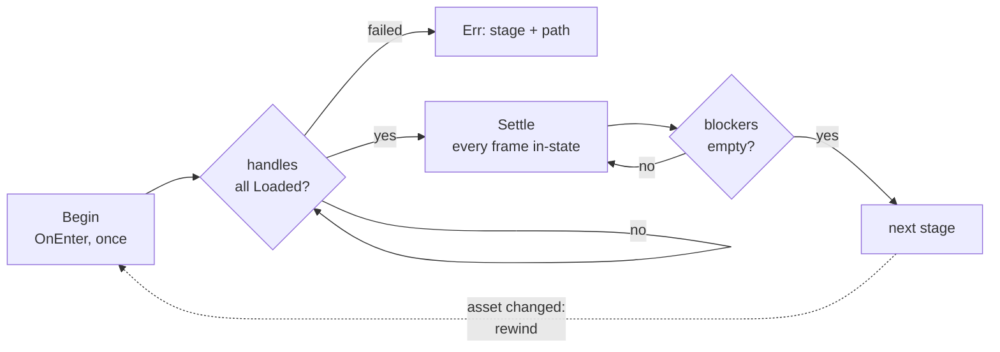

# 11 — Staged Asset Loading

Design plan for replacing the single `PendingAssets` gate with an ordered,
multi-stage load. Drafted 2026-10-30, revised the same day, nothing implemented
yet. Formalizes item 3 of [[03 Phase 0 - Foundation]] ("Loading game assets").

The ask, as stated: load in stages, the last being gameplay, with intermediate
stages because some assets depend on others; a descriptor saying what's
required; possibly a generated asset→stage map from the asset build script;
and a clean stage-transition mechanism.

One part of that premise needs adjusting before any of it gets built, so that
comes first.

> **Revision, same day.** The first draft used a hand-rolled driver over custom
> schedules, and treated hot reload as a second code path alongside the stages.
> Both were replaced after the observation that **a stage sequence is a state
> machine, and state machines transition backwards too** — so hot reload is a
> rewind through the same stages, not a parallel mechanism. That removes the
> dual-path design entirely and makes real Bevy `States` the better substrate.
> The superseded options are kept at the end of the transition section, because
> the reasoning for *why* they lost is the useful part. Affected sections are
> marked.

## The triage: Bevy already resolves asset→asset dependencies

`recursive_dependency_load_state` is *transitive*. This is already load-bearing
in the current code — `terrain::spawn_test_world` tracks exactly one handle for
`test_world.scn.ron`, and that one handle covers all 7 glTF scenes it
references plus the character mesh underneath them (see `PendingAssets`'s doc
comment, and [[06 Assets and Scenes]]). Any dependency a *loader* declares, via
`LoadContext::load`, is already waited on with no staging whatsoever.

So "asset A references asset B" is, on its own, not a reason for a stage. If it
were, stages would be a worse reimplementation of something the engine does
better. What *does* need a stage is a dependency that crosses out of the asset
system — five kinds, and only these:

| Kind | Example in this project | Does Bevy cover it? |
|---|---|---|
| Loader dependency | `.scn.ron` → `.glb` → textures | **Yes**, transitively. No stage. |
| Name not known until a load finishes | a unit roster index that lists which unit defs exist | **No.** Inherently a stage boundary. |
| Runtime-derived asset | `AnimationGraph` built from 3 loaded glTFs | **No.** This is today's `Initialize`. |
| Logical-name resolution | a unit def saying `script: "aggressive"`, resolved against a registry rather than a path | **No**, if it's a name. **Yes**, if you make it a path and `load_context.load` it. |
| Entity-level fact | the scene instance spawned, so an `AnimationPlayer` now exists | **No.** Not an asset fact at all. Today's `CharacterSceneSpawned`. |
| GPU pipeline warm | shaders compile lazily on first draw; "loaded" ≠ "renders without a hitch" | **No.** `showcase/loading_screen.rs` is the reference. |

Which gives the actual definition to build against:

> **A stage boundary exists where code must run between two loads** — because
> the next load can't be *named*, or the next asset doesn't exist on disk and
> has to be *derived*, or the thing being waited for isn't an asset at all.

That definition is worth more than it looks, because it also tells you what the
*number* of stages is: it's the number of distinct derive/resolve steps you
have written. Which is a compile-time quantity. More on that below.

## Stage model

A stage is a label plus two hook points and a gate:



- **Begin** — runs once, when the stage becomes current. Its systems *name*
  loads and track them on the stage. This is the hook that makes dynamic
  content work: a `Begin` system can read assets loaded by any earlier stage,
  so a roster index loaded in stage N tells stage N+1 what to load.
- **Gate** — the driver folds `recursive_dependency_load_state` over the
  stage's tracked handles. Not a user hook; it's `PendingAssets::progress`
  as it exists today, scoped to one stage.
- **Settle** — runs every frame *after* the gate is green, until nothing is
  blocking. Derived assets get built here, and entity-level waits live here.

**Settle running only once the gate is green is the important property**, and
it's one the current code already paid for: `build_character_animation_graph`
has no readiness guard because entering `Initialize` already proves the loads
succeeded. Keeping the gate ahead of Settle preserves that — derive steps stay
guard-free, and a missing file is still an `Err` with a path in it rather than
an `.expect()` in an unrelated-looking function.

### Completion is a set of named blockers, not a boolean

A stage is done when its handles are loaded **and** its blocker set is empty:

```rust
/// The current stage's gate. One of these, not one per stage: `OnExit` clears
/// it, so it only ever describes the stage being entered - which is also what
/// makes re-entering a stage after a rewind clean.
#[derive(Resource, Default)]
pub struct StageGate {
    handles: Vec<UntypedHandle>,
    blockers: HashSet<&'static str>,
}

impl StageGate {
    /// Same role `PendingAssets::track` has today, scoped to one stage.
    pub fn track(&mut self, handle: impl Into<UntypedHandle>) {
        self.handles.push(handle.into());
    }

    /// Holds the stage open under a name. The name is what the loading screen
    /// and the log line show, so it should read as the thing being waited for.
    pub fn block(&mut self, reason: &'static str) {
        self.blockers.insert(reason);
    }

    pub fn release(&mut self, reason: &'static str) {
        self.blockers.remove(reason);
    }
}
```

Why blockers rather than "each stage has a `ready` condition": it makes stage
completion **open for extension without the driver knowing anything**. Any
plugin can hold any stage open — `CharacterControllerPlugin` blocks
`instantiate` on `"character-animation-player"` and releases it when the player
is attached, and the driver never learns that characters exist. It also hands
you the loading-screen text and the "what are we stuck on?" log line for free,
which a boolean cannot. "All handles loaded" is then just the one blocker the
driver owns itself.

This is the generalization of what `finish_character_initialization` does today
by returning early and retrying — same retry loop, but the reason it's waiting
becomes a value rather than an implicit early-return.

## The transition mechanism

**Revised 2026-10-30**, after the observation that a stage sequence is a state
machine, and a state machine's transitions go backwards as well as forwards.
That turns out to be the requirement that settles this section, so the original
four-way comparison is recorded at the end for the record rather than up front.

The earlier draft rejected "one state per stage" because the stage list had to
be dynamic, and then [§On a dynamic number of stages](#on-a-dynamic-number-of-stages)
argued the list should be a compile-time `const`. Those two positions can't both
stand. With a `const` stage list, a plain `States` enum is back on the table —
and it is the only candidate where a **backward** transition is a primitive
instead of something bolted on:

```rust
/// Deliberately *not* a `SubStates` of `GameState::Loading` - see the hazard
/// below, which is the whole reason this is its own state.
#[derive(States, Clone, Copy, PartialEq, Eq, Hash, Debug, Default)]
pub enum LoadStage {
    #[default]
    Boot,
    Index,
    Content,
    Derive,
    Instantiate,
    Warm,
    /// Terminal: everything loaded, derived, instantiated and warm.
    Settled,
}

impl LoadStage {
    pub const ORDER: &'static [LoadStage] = &[
        Self::Boot, Self::Index, Self::Content,
        Self::Derive, Self::Instantiate, Self::Warm, Self::Settled,
    ];

    pub fn position(self) -> usize {
        Self::ORDER.iter().position(|s| *s == self).expect("in ORDER")
    }

    pub fn next(self) -> LoadStage {
        *Self::ORDER.get(self.position() + 1).unwrap_or(&Self::Settled)
    }

    /// Whichever of the two comes first. Used to coalesce rewind requests.
    pub fn earliest(self, other: LoadStage) -> LoadStage {
        if other.position() < self.position() { other } else { self }
    }
}
```

What this buys, all of it native:

| Need | Native mechanism |
|---|---|
| Begin hook | `OnEnter(LoadStage::Content)` |
| Settle hook | `Update.run_if(settling(LoadStage::Derive))` |
| **Backward transition** | `next_state.set(LoadStage::Derive)` |
| **Undo on leaving a stage** | `OnExit(..)`, and `DespawnOnExit<LoadStage>` for entities (`bevy_state-0.20.0/src/state_scoped.rs:145`) |
| Ordering against asset insertion | `StateTransition` is installed after `PreUpdate`, so an `OnEnter` can never observe a load before `Assets<T>` has it — the caveat [[06 Assets and Scenes]] documents, handled for free |

Registration stays as cheap as the custom-schedule version:

```rust
// CharacterControllerPlugin::build
app.add_systems(OnEnter(LoadStage::Content), load_character_gltf_handles);
app.add_systems(Update, build_character_animation_graph.run_if(settling(LoadStage::Derive)));
app.add_systems(Update, finish_character_initialization.run_if(settling(LoadStage::Instantiate)));
```

`settling` is what preserves the guard-free-derive property — it's `in_state`
plus "this stage's handles are all loaded", so a derive step still needs no
readiness check of its own:

```rust
/// A derive step gated on this cannot observe a half-loaded stage, which is
/// what lets `build_character_animation_graph` keep having no readiness guard.
pub fn settling(stage: LoadStage) -> impl Fn(Res<State<LoadStage>>, Res<StageGate>) -> bool + Clone {
    move |current, gate| *current.get() == stage && gate.is_ready()
}
```

### The driver shrinks to two systems

No exclusive world access, no `try_run_schedule`, no `resource_scope` trap —
all of that existed only to hand-roll what `StateTransition` already does:

```rust
fn advance_stage(
    current: Res<State<LoadStage>>,
    gate: Res<StageGate>,
    asset_server: Res<AssetServer>,
    mut next: ResMut<NextState<LoadStage>>,
) -> Result<(), BevyError> {
    let stage = *current.get();
    if stage == LoadStage::Settled {
        return Ok(());
    }

    match gate.progress(&asset_server) {
        AssetLoadProgress::Loading => return Ok(()),
        AssetLoadProgress::Failed(failures) => {
            return Err(format!(
                "load stage {stage:?}: {} asset(s) failed:\n  {}",
                failures.len(),
                failures.join("\n  ")
            )
            .into());
        }
        AssetLoadProgress::Ready => {}
    }

    // Settle systems ran this frame (same `Update`, ordered before this);
    // if nothing is still holding the stage open, move on.
    if gate.blockers_clear() {
        next.set(stage.next());
    }
    Ok(())
}
```

…plus `apply_rewind`, in the hot-reload section below. `StageGate` is the
per-stage `handles` + `blockers` from the stage model above, reset in
`OnExit(..)` — which is also what makes re-entry clean.

### The hazard: `LoadStage` must not be a `SubStates` of `GameState::Loading`

This is the one thing that will break the whole design if it's got wrong, and
it's non-obvious.

If stages are a sub-state of `GameState::Loading`, then rewinding to re-run a
derive step means **re-entering `GameState::Loading`** — which exits
`GameState::Playing`, which despawns everything carrying
`DespawnOnExit(GameState::Playing)` and re-runs every `OnEnter(Playing)` setup.
Editing one texture would reset the match.

So `LoadStage` is an independent `States` with a terminal `Settled` variant, and
`GameState::Playing` is entered once, on `OnEnter(LoadStage::Settled)`, and
never left by a rewind. A hot reload moves `LoadStage` backwards while
gameplay keeps running.

The consequence to accept: gameplay must tolerate a derived resource being
briefly absent or mid-rebuild. The current code already does, and not by
accident — `apply_character_animation` takes `Option<Res<CharacterAnimations>>`
and early-returns, as does `finish_character_initialization`. Those guards were
written for the cold-load race and happen to be exactly what a rewind needs,
so this is a property the codebase already has rather than one to add.

### For the record: the options this replaced

- **One `GameState` variant per stage** — what exists today. Rejected at 6
  stages for the usual reason (adding a stage edits the enum plus every gate),
  but the mechanism was right; the fix is a *separate* state enum, not a
  non-state.
- **`SubStates` carrying an index** (`LoadPhase(usize)` under `Loading`) —
  rejected: you can't write `OnEnter(LoadPhase(3))` against a data-driven list,
  and sub-stating under `Loading` is precisely the hazard above.
- **Plain resource + one-shot systems (`SystemId`)** — fully dynamic, but every
  hook needs registering and storing by hand, and multi-system stages lose
  normal ordering and parallelism.
- **Plain resource + one custom schedule per hook per stage** — the original
  recommendation here, keyed by an interned `StageLabel(&'static str)` and run
  via `World::try_run_schedule` (which tolerates a missing schedule:
  `bevy_ecs-0.20.0/src/world/mod.rs:3983`). It works, and it's the right answer
  *if* the stage list ever has to be runtime data. It isn't, so it was paying
  for dynamism it didn't use — and it would have had to reimplement backward
  transitions, `OnExit` cleanup and the `PreUpdate`/`StateTransition` ordering
  guarantee by hand.

## The descriptor

Three separate questions got bundled into "a descriptor"; they have different
answers.

### 1. Stage order → a Rust `const`, not a data file

That's the `LoadStage` enum and its `ORDER` const from the transition section
above — the same `(name, value)` table idea `CONFIG_READERS`,
`CHARACTER_ANIMATIONS` and `KEYCODES` already use in `utils::constants`, just
expressed as a `States` enum because that's what the state machine needs.
Reasons to keep it in Rust rather than RON:

- **A stage without Rust systems does nothing.** Adding a stage means adding
  systems to its `OnEnter`/`settling(..)` hooks — it's inherently a code
  change, so putting the order in a data file creates a file that can't be
  meaningfully edited on its own, plus a new failure mode (a RON stage nobody
  registered systems for).
- **Bootstrapping.** A load plan that is itself a loaded asset has to answer
  "which stage loads the load plan?". Making it a `const` deletes the question.
- **`States` requires it.** `OnEnter`/`OnExit`/`in_state` all need a type with
  known variants. This is the constraint that decided the mechanism; see the
  transition section.

The counter-argument, recorded in case it ever applies: if a non-programmer
ever needs to reorder stages without a rebuild, RON wins — and that would mean
going back to the custom-schedule mechanism, since a `States` enum can't be
data. That isn't the case now and probably never is, because the order follows
the derive steps.

### 2. Stage membership → system registration, not a generated map

This is the part of the original plan I'd drop. "Which assets belong to stage
N" is already fully expressed by *which stage's `OnEnter` system loads them* —
`load_character_gltf_handles` registered on `OnEnter(LoadStage::Content)` **is**
the statement that the character clips are content-stage assets. A generated
asset→stage map would be a second, derived copy of that, and a build script
can't produce it anyway: it would have to infer design intent (is this mesh
needed at boot or at level 3?) from a directory listing.

The one place a *runtime* asset→stage mapping is genuinely needed is the rewind
lookup in the hot-reload section — and there it's per asset *type* per consuming
stage, declared in one line of plugin wiring, not per file.

### 3. What the game loads → the asset description ([[12 Asset Description]])

**Rewritten 2026-10-30.** The first two attempts at this section both got the
model wrong: the hardcoded `GROUPS` table in `build.rs`, then a manifest of
"load roots" with `test_world.scn.ron` as the worked example. The second is the
instructive failure — it described Bevy's *file* reachability rather than the
game's *content*, which makes worlds the entry point and therefore makes shared
content, unreferenced-but-valid content, and up-front verification all
awkward-to-impossible. [[12 Asset Description]] has the full argument and the
format; what matters here is the consequence for staging.

The asset description is a declared inventory of content *entities* — textures, models,
animations, properties, skills, units, worlds — referencing each other by typed
logical ID (`Model("knight")`), resolved and fully validated before anything
heavy loads. Two consequences reshape the stage list:

- **Worlds load last, not first.** A world is the most derived kind in the
  asset description: it names units, which name models and skills, which name
  animations and textures. It gets its own late stage rather than being the
  root whose dependencies drag everything else in.
- **There is a load-free validation stage.** Resolving IDs to indices and
  proving nothing dangles is pure computation between two loads, which is
  exactly the stage-boundary criterion from §triage. It is also the stage that
  earns the whole design: a missing skill reference fails with a list of every
  problem at once, before a single mesh is fetched.

#### The generated inventory is still worth it, for a narrower job

What a build script knows and Rust otherwise doesn't is **what files exist**.
With the asset description owning *which* content exists, the generated artifact's job
shrinks to verification plus the one case where a directory listing is the
right answer:

- **`load_folder` is silently broken on wasm.** It looks like the native answer
  to "load every file in this directory", and on desktop it works —
  `LoadedFolder.handles` is `#[dependency]`, so one folder handle covers the
  directory recursively under `recursive_dependency_load_state`. But
  `bevy_asset`'s `HttpWasmAssetReader::read_directory` logs
  `"Reading directories is not supported"` and returns an **empty** stream
  (`bevy_asset-0.20.0/src/io/wasm.rs:132`): zero assets, folder reports loaded.
  `Cargo.toml` has a `wasm-release` profile, so this is live. If a kind ever
  wants "everything in `units/`" rather than explicit entries, it needs a
  generated list, not `load_folder`.
- **Dangling file references become build errors.** A path in a declared entry
  that doesn't exist on disk is checkable at build time, and is currently a
  runtime load failure. This is the exact check, as opposed to the heuristic one
  below.
- **Orphan detection.** Files under `data/assets/` that no declared entry
  names: dead weight or a missing entry. A warning rather than an error, since
  a world editor legitimately wants content nothing references yet, with an
  explicit allow-list to keep it honest. Against the repo as of 2026-10-30 this
  finds three immediately — `models/character/Fox.glb`,
  `.../basic_character/Running.glb` and `.../basic_character/Zombie_Attack.glb`
  are named by no `.rs` and no `.ron`.
- **Progress weights.** Transitive closure size per declared entry, so a
  loading bar weights a world (9 files) above a single property declaration.

#### When to build it

The asset description itself is the near-term work — it's what removes the path
constants and makes the content data-driven. The build-time half can trail it:

1. **`tools/check_assets.sh`** — dangling + orphan checks as a script. Needs no
   asset-description machinery, no codegen, no build integration, and finds
   the three dead files today.
2. **Fold the same checks into `build.rs`** once `assets.dsc.ron` exists, so a
   bad reference fails the build rather than the run.
3. **Generated per-kind path lists** only if a kind outgrows explicit entries.
   Possibly never.

### 4. Runtime-discovered names → one stage's `OnEnter` reading the last one's assets

The case no build-time artifact can cover: an asset whose *contents* name what
to load. The asset description has exactly two such instances — `assets.dsc.ron`
(parsed as `AssetDescriptionIndex`) naming the per-kind files, and the resolved
`AssetDescription` naming the payload — and each is a stage boundary for
precisely this reason:

```rust
// OnEnter(LoadStage::Payload)
fn load_payload(
    asset_server: Res<AssetServer>,
    description: Res<AssetDescription>,
    mut gate: ResMut<StageGate>,
) {
    // No readiness guard: `Resolve` completed, so every path here came from an
    // entry that validated. `StateTransition` runs after `PreUpdate`, so
    // anything `Declarations` loaded is already in `Assets<T>`.
    for animation in description.animations() {
        gate.track(asset_server.load::<Gltf>(&animation.clip));
    }
    for model in description.models() {
        gate.track(asset_server.load::<Scene>(&model.scene));
    }
}
```

This is also the answer to "which asset belongs to which stage" in its final
form: **not a field in the descriptor and not a computed map, but which stage's
`OnEnter` reads `AssetDescription` for it.** The asset description says what
exists; a dozen lines of Rust across a handful of stages say when.

#### `assets.dsc.ron` needs a dedicated loader, its own stage, and hot reload — all three, and none of them optional

**Added 2026-10-30.** Raised as a question — should the root descriptor have
its own `AssetLoader` type, load first in its own state, and support hot
reload? Yes to all three, and the first one is load-bearing for the rest of
this page rather than a nice-to-have: `OnEnter(LoadStage::Declarations)` has to
ask "which files did the root name?", and the only way to ask that through the
asset system is `Res<Assets<AssetDescriptionIndex>>::get(&handle)`. There is no
untyped version of that call. Skipping the dedicated type doesn't simplify
anything — it just forces a `std::fs::read_to_string` + manual `ron::from_str`
outside the asset system, which is exactly the out-of-band read this project
already rejected for `ButtonConfig` once that file had no pre-`App` constraint
(see `utils::system_config`'s module doc).

**The type.** `resources::button_config::ButtonConfigLoader` (`src/resources/button_config.rs:53-54`)
is the template, already compiling and tested in this repo:

```rust
#[derive(Asset, TypePath)]
pub struct AssetDescriptionIndex {
    pub kinds: Vec<(ContentKind, String)>,
}

#[derive(Default, TypePath)]
pub struct AssetDescriptionIndexLoader;

impl AssetLoader for AssetDescriptionIndexLoader {
    type Asset = AssetDescriptionIndex;
    type Settings = ();
    type Error = BevyError;

    async fn load(
        &self,
        reader: &mut dyn Reader,
        _settings: &(),
        _load_context: &mut LoadContext<'_>,
    ) -> Result<AssetDescriptionIndex, BevyError> {
        // Same read-to-end -> &str -> ron::from_str shape as ButtonConfigLoader.
        // ...
    }

    fn extensions(&self) -> &[&str] {
        &["ron"]
    }
}
```

Note the name split this forces, and why it's worth keeping: `AssetDescriptionIndex`
is the raw kind→file list parsed straight off `assets.dsc.ron`; `AssetDescription`
(§3 above) is the fully resolved, validated resource `Resolve` builds from
everything `Declarations` loaded using that list. They're different types with
different lifetimes — the Index exists only to drive one `OnEnter`, the
`AssetDescription` is what every later stage reads — and collapsing their names
back into one "catalogue" is the ambiguity this rename exists to remove.

The same reasoning applies to every per-kind file (`models.ron`, `units.ron`, …)
— `Resolve` needs `Res<Assets<RawModelFile>>` etc. for the identical structural
reason. Eight hand-rolled loaders differing only in their `Asset` type is the
obvious next question; a generic `RonAssetLoader<T>` implementing `AssetLoader`
once and registered per `T` is the standard answer (`bevy_common_assets`'s
`RonAssetPlugin<T>` does this, as I recall — confirm its current API against
the crate before depending on it rather than hand-rolling eight copies).

**Its own stage.** Already true, not a new requirement: `Index` is a stage
distinct from `Declarations` *because* the file list isn't knowable until the
root is parsed — the canonical "name not known until a load finishes" boundary
from §triage. Nothing about adding the loader type changes the stage table;
the type is what makes `OnEnter(LoadStage::Declarations)`'s read of
`AssetDescriptionIndex` well-typed instead of hypothetical.

**Hot reload.** Also already covered by [§Hot reload is a backward
transition](#hot-reload-is-a-backward-transition-not-a-second-code-path), and
it's the simplest registration in the whole scheme, because it's the one case
with no ambiguity about which stage consumes the asset — there's exactly one
reader, `Declarations`'s `OnEnter`:

```rust
app.add_systems(Update, rewind_on_change::<AssetDescriptionIndex>(LoadStage::Index));
```

The honest caveat: it's also the *widest possible* rewind target in the system.
Editing `assets.dsc.ron` invalidates everything downstream — `Declarations`,
`Resolve`, `Payload`, `Derive`, `World`, `Instantiate` all re-run, and the last
two aren't free to re-enter (see §re-entrancy costs). Still correct under the
re-entrancy rules already specified for every stage; just the slowest reload
the design can produce, which is worth knowing going in rather than discovering
mid-edit.

## On a dynamic number of stages

I'd not build it, and the reasoning is the stage definition above: a stage
exists because *code* runs between two loads, and code is compile-time. So the
stage count is bounded by the derive steps you've written, and `LoadStage` can
be an enum — which, per the transition section, is what makes the whole
state-machine mechanism (and therefore the rewind-based hot reload) available
at all. This conclusion is load-bearing for the rest of the design, not just a
scoping preference.

What is genuinely dynamic is covered without a variable stage list:

- **Stage contents** — how many unit defs, which level's meshes. Handled by
  `OnEnter` systems reading indices.
- **Skipped stages** — a stage with no registered systems tracks nothing and
  blocks nothing, so `advance_stage` moves through it the frame it's entered.
  No special case needed.

The one case that would actually need unbounded stages is **recursively nested
manifests** (an index that can name another index, to arbitrary depth). If that
ever becomes real, the fix is a *self-transition* rather than a growing list:
re-set `NextState` to the stage you're already in, which re-runs `OnExit` (which
clears the gate) and `OnEnter` (which re-reads the now-larger index), with an
iteration cap to turn a cyclic index into an error instead of a hang. The
backward-transition machinery already needed for hot reload covers this case
too — it's the same primitive with a target of "here".

## Hot reload is a backward transition, not a second code path

**Revised 2026-10-30.** The original version of this section proposed splitting
every derive step in two: the real work in `Update` reacting to
`AssetEvent::Added | Modified` (the shape `apply_button_config` already has),
plus a `Settle` system that only waits for the output to exist. That was wrong,
or at least needlessly expensive, and the reason is worth stating because it
generalizes:

> A second code path that only runs in a situation you rarely test will rot
> without telling you.

Hot reload is a dev-loop feature. A dual-path design means the hot-reload path
is exercised only when someone happens to edit a file while the game is
running, so it can break silently for weeks. **Replaying the stages instead
means hot reload and cold load are the same code.** If the reload path breaks,
startup breaks, and you find out on the next `cargo run`. That is a much
stronger guarantee than "we wrote both paths carefully", and it's worth more
than the handful of lines the dual-path version saved.

So: on an asset change, set `LoadStage` **back** to the earliest stage whose
work consumed that asset, and let the machine run forward again.

```rust
/// Coalesces every rewind asked for this frame. Editors fire several
/// `Modified` events per save, and a multi-file save can name several stages.
#[derive(Resource, Default)]
pub struct RewindRequest(Option<LoadStage>);

impl RewindRequest {
    pub fn to(&mut self, stage: LoadStage) {
        self.0 = Some(match self.0 {
            Some(current) => current.earliest(stage),
            None => stage,
        });
    }
}

/// One instance per (asset type, consuming stage).
fn rewind_on_change<A: Asset>(
    stage: LoadStage,
) -> impl FnMut(MessageReader<AssetEvent<A>>, ResMut<RewindRequest>) + Clone {
    move |mut events, mut request| {
        if events.read().any(|e| matches!(e, AssetEvent::Modified { .. })) {
            request.to(stage);
        }
    }
}

fn apply_rewind(
    mut request: ResMut<RewindRequest>,
    current: Res<State<LoadStage>>,
    mut next: ResMut<NextState<LoadStage>>,
) {
    let Some(target) = request.0.take() else {
        return;
    };
    // Only ever backwards. A change to something a later stage consumes will be
    // picked up when the machine reaches that stage anyway.
    if target.position() < current.get().position() {
        next.set(target);
    }
}
```

Registered per consuming stage, which is one line each:

```rust
app.add_systems(Update, rewind_on_change::<Gltf>(LoadStage::Derive));
app.add_systems(Update, rewind_on_change::<ButtonConfig>(LoadStage::Boot));
```

### Why the rewind target is the *consuming* stage, not the loading stage

Editing `Idle.glb` does not require re-running `Content`: `AssetServer` has
already reloaded the clip itself by the time the event fires. What's stale is
the `AnimationGraph` *derived* from it. So the target is `Derive`. Getting this
backwards isn't harmful, just wasteful — re-running `Content` re-issues
`asset_server.load` calls that return cached handles.

That asymmetry is the safety valve for the whole design: **over-rewinding is
always safe, under-rewinding leaves something stale.** So when a mapping is
unclear, pick the earlier stage. It also means the per-type registration above
can stay coarse — "any `Gltf` changed → rewind to `Derive`" is fine even once
there are glTFs that nothing derives from.

### Verified: the events arrive on the handle you actually tracked

The obvious worry is that a stage tracks `test_world.scn.ron` while the file
that changed is a texture three levels down, so `AssetEvent::Modified` fires for
an id no stage ever tracked. That turns out not to be a problem:
`AssetInfos` keeps a `loader_dependents` reverse map, and the file watcher's
`queue_ancestors` walks it **transitively**, queueing every dependent path for
reload as well (`bevy_asset-0.20.0/src/server/mod.rs:1950-1961`, called from
`reload_path` at `:1982`). So changing a texture reloads the glTF, which
reloads the `.scn.ron` — and `Modified` fires for the tracked root too, not just
the leaf. Stage-level reload mapping is sound without reimplementing dependency
tracking.

(`loader_dependents` itself is private, so you can't query it directly. You
don't need to — you get the events.)

### What re-entrancy costs

This is the real price of the model, and it's a discipline rather than a
mechanism. A stage that cold-loads into a fresh world will, on replay, run
against a world that already holds the previous run's results:

- **Tracked handles must be cleared** on leaving a stage, or they accumulate
  duplicates across replays. That's `OnExit(stage)` resetting `StageGate` —
  one system for all stages, generic over nothing.
- **Derive steps are naturally idempotent.** `commands.insert_resource(..)`
  overwrites; `Assets::add` returns a fresh handle and the old
  `AnimationGraph` drops when the last handle does. Nothing to change.
- **Spawning stages are not.** Anything `instantiate` spawns needs
  `DespawnOnExit(LoadStage::Instantiate)` or an equivalent, or a replay
  double-spawns it. Worth noting that today's `finish_character_initialization`
  is already safe here — it queries `Without<AnimationGraphHandle>`, so a
  second run is a no-op — but that was luck, and new instantiate-stage systems
  need it on purpose.
- **Blockers must be re-armed, not just released.** A plugin that blocks a
  stage in `OnEnter` and releases it in `Settle` works on replay; one that
  blocks it from `Startup` would only ever do so once.

None of that is free, but it's *local, inspectable* discipline — "this stage
must be safe to re-enter" is a property you can state and review per stage.
The dual-path alternative's requirement was "this reload system must stay
behaviourally identical to a different system somewhere else", which is neither
local nor checkable.

### Bonus: level switching falls out of this

[[03 Phase 0 - Foundation]] item 4 wants level *switching*, which under this
model is a rewind with a wider target: set `LoadStage` back to `Index`, point
the level index at a different file, and the machine reloads content, re-derives
and re-instantiates through the same path as startup. No separate
"unload the level" routine, and no third code path.

## Proposed stages for this project

**Revised 2026-10-30** for [[12 Asset Description]]: worlds moved to a late
stage, and `Resolve` was added as a load-free validation gate. (The stage
formerly named `Catalogue` is `Index` below — renamed alongside the resolved
resource, `AssetDescription`, to keep the two distinct.)

| Stage | Purpose | Loads? | Has content today? | Re-entrant? |
|---|---|---|---|---|
| `Boot` | What the loading screen itself needs (font, button config). Must finish before progress can be *displayed*. | yes | Yes — `button_config.ron` moves here | Trivially |
| `Index` | `assets.dsc.ron` only — the standalone descriptor at the top of `data/assets/`, parsed as `AssetDescriptionIndex`. Names the per-kind declaration files, so this is a genuine name-not-known-yet boundary. | yes | No — new | Trivially |
| `Declarations` | Every per-kind file `AssetDescriptionIndex` named. Small text files, fully parallel. | yes | No — new | Trivially |
| `Resolve` | **No loading.** Resolve every ID to an index in one pass, prove the reference graph acyclic, report every problem found at once, build the `AssetDescription` resource. | no | No — new | Yes, rebuilt wholesale |
| `Payload` | The heavy binaries the resolved `AssetDescription` points at: meshes, textures, animation clips. Exact denominator, fully parallel. | yes | Yes — character clips | Yes, loads are cached |
| `Derive` | Runtime-built assets: `AnimationGraph`, atlases, compiled scripts. | no | Yes — `build_character_animation_graph` | Yes, `insert_resource` overwrites |
| `World` | The chosen `World` entry's `.scn.ron`. Last, because it references IDs that are by now known-valid. | yes | Yes — `test_world.scn.ron` | Needs despawn of the previous world |
| `Instantiate` | Scene spawn + entity-level waits. | no | Yes — `finish_character_initialization` | **Needs care** — see re-entrancy costs |
| `Warm` | Pipeline/shader warm-up before gameplay. | no | No — add when content is big enough to stutter | Yes |
| `Settled` | Terminal. `OnEnter` sets `GameState::Playing` (once, ever). | — | — | — |

Three of these earn comment:

- **`Boot` exists because the loading screen has assets of its own**, so there
  must be a stage before the one it reports on. [[11 UI]] and
  `showcase/loading_screen.rs` are the references for the screen itself.
- **`Resolve` is the stage that justifies the architecture.** It loads nothing
  and is pure computation between two loads — the §triage criterion exactly —
  and it's where "verify there are no missing pieces before operating" lives. It
  can technically be collapsed into `OnEnter(Payload)`, since that system has to
  read the resolved `AssetDescription` to know what to track; keeping it separate buys
  clean error attribution and a distinct "Validating content…" progress label,
  which is worth one state variant.
- **`World` being late is the point of the asset-description revision.** It
  also makes the world-editor case fall out for free: an editor needs
  `AssetDescription` resolved and the payload loaded but no world at all, which
  is just a different terminal stage — stop at `Derive`.

The re-entrancy column is the load-bearing one for hot reload: it's the
per-stage property the rewind model asks you to state and review. `Instantiate`
and `World` are the two where it isn't free.

## Migration path

Each step is independently landable and leaves the app working. Two tracks —
the **machine** (steps 1–4) and the **asset description** (5–8) — which meet at step 6.

**Machine track**

1. **`PendingAssets` → `StageGate`.** Mechanical: add the named-blocker set
   alongside the existing handle list, keep `progress` as-is. No behavior
   change, nothing else moves yet.
2. **Add the `LoadStage` enum + `advance_stage` + the `OnExit` gate reset.**
   Start with the stages that have content *today* only — `Payload`, `Derive`,
   `Instantiate`, `Settled` — with the current load systems on
   `OnEnter(LoadStage::Payload)` and the two `Initialize` systems on
   `settling(..)`. `GameState` collapses to `Loading`/`Playing` in the same
   step, since `Initialize` has nowhere left to live. Net deletion, and it
   proves the machine before any asset-description work.
3. **Make `Instantiate` re-entrant** — `DespawnOnExit(LoadStage::Instantiate)`
   on anything it spawns, blockers armed in `OnEnter` rather than `Startup`.
   Before step 4, because step 4 is what starts exercising re-entry.
4. **Add `RewindRequest` + `apply_rewind` + one `rewind_on_change::<T>` per
   consuming stage.** Hot reload starts working here, through the same path as
   cold load. Verify by editing `button_config.ron` and an animation glTF with
   the app running and `file_watcher` enabled.

**Asset description track** ([[12 Asset Description]])

5. **`tools/check_assets.sh`** — dangling + orphan checks as a script.
   Independent of everything else, and worth doing first for the quick win: it
   finds three dead asset files today.
6. **Add the asset description: raw types, `assets.dsc.ron` + per-kind files, the
   resolve/validate pass**, and the `Index`/`Declarations`/`Resolve` stages
   in front of `Payload`. Migrate `CHARACTER_ANIMATIONS` and `TEST_WORLD_PATH`
   into entries; `Payload` now tracks what the resolved `AssetDescription`
   names rather than what a constant does. This is where the path constants die.
7. **Split `World` out of `Payload`** as its own late stage, so the world
   references an `AssetDescription` that's already proven complete. Level
   switching becomes a rewind to `World` (or `Resolve`, if the asset
   description itself changed).
8. **Add `Boot` + the loading screen**, driven by a `LoadProgress` resource
   (`stage`, `position`/`ORDER.len()`, `loaded`/`total`,
   `waiting_on: Vec<&'static str>` — the blocker names), with per-entry
   progress weights from the asset-description scan. Then `Warm` when a first-frame
   stutter is actually observable.

Steps 1–4 should land together-ish, since 4 is what makes the machine worth
having. 5 is free. 6 is the substantial one and the real goal — everything
before it is scaffolding that makes 6 safe to attempt.

### Testability

Worth calling out because it's a change from today, and the rewind model makes
it matter more: the machine is testable without files or a window. A
`MinimalPlugins` + `AssetPlugin` app, a gate blocked on a name a test system
releases on frame 3, and assertions on `State<LoadStage>` per frame covers
enter-once, blocker release and advance with no assets involved. **The rewind
path is the one that most needs tests** — set `RewindRequest` directly, assert
the state went backwards, assert it doesn't go backwards past a change in a
later stage, and assert a stage that spawns doesn't double-spawn across a
replay. That last one is the regression this design can actually suffer, so it
should be the first test written.

The current `GameState` machine has no equivalent test, which is why its two
regressions were both found by reading rather than by failing.

## What I'd deliberately not build

- **A dependency-graph solver.** `recursive_dependency_load_state` is the solver.
- **A reverse dependency map for rewind targeting.** `queue_ancestors` already
  propagates reloads up to the handle you tracked — see the verified note above.
- **A generated asset→stage map, even one computed from the reference graph** —
  the reference graph and the stage graph are different graphs; see descriptor
  §2 and §3.
- **A descriptor built around load roots** rather than content entities — the
  mistake the second draft of descriptor §3 made; see
  [[12 Asset Description]] §"The mistake this corrects".
- **Depth-sorting the content reference graph into load stages.** Topological
  order over content references is the wrong axis: it serializes loads that are
  independent. The sort's job is cycle detection, inside one stage — see
  [[12 Asset Description]] §"What the topological sort is for".
- **`load_folder`** on anything that must work in `wasm-release`.
- **A separate hot-reload code path** — that's the point of the revision.
- **`LoadStage` as a `SubStates` of `GameState::Loading`** — see the hazard.

## Where this fits

- ⬅ Builds on: [[06 Assets and Scenes]] (the dependency-tracking mechanics and
  the `AssetBarrier` history), [[15 State Management]] (the current
  `Loading`/`Initialize`/`Playing` machine this replaces)
- ➡ Enables: [[05 Phase 2 - AI Scripting]] (script assets, a script registry,
  hot-reloaded scripts), [[03 Phase 0 - Foundation]] item 4 (level switching —
  a level change is a rewind to `LoadStage::Index`, i.e. the same primitive as
  hot reload with a wider target)
- 🔗 Related: [[13 Staged Asset Loading - Diagrams]] (class, object, component
  and sequence diagrams of the implemented machine track — start there for the
  frame-by-frame ordering, which is where most of this page's properties come
  from), [[12 Asset Description]] (what gets loaded through these stages,
  and the reason the stage list has a `Resolve` and a late `World`), [[11 UI]]
  (`showcase/loading_screen.rs`), [[20 Platform Targets]] (the wasm
  directory-listing trap), [[01 Cleanup Backlog]]

Note for whoever implements this: [[06 Assets and Scenes]] §"Waiting on a batch
of loads" and [[15 State Management]]'s "Used in `game`" both still describe the
`AssetBarrier`/`check_character_ready` design, removed 2026-10-28. Those
sections need rewriting against the current code before they're rewritten
against this plan.
