# 13 — Staged Asset Loading: Diagrams

Structural and behavioural diagrams for the draft in `src/systems/asset_loading/`,
which implements the machine track (steps 1–4) of [[11 Staged Asset Loading]].
Drawn 2026-11-02 against the code as written, not against the design doc — where
the two differ (`poll_gate` being its own system, `despawn_on_replay` instead of
`DespawnOnExit`), these follow the code and say so.

Read in order: the mapping note first, then §1–§3 for *what the pieces are*, §4
for *what a frame does*. The sequence diagrams are the ones that actually explain
the design; the rest is vocabulary for reading them.

Generic types are written Rust-style in prose (`Handle<Gltf>`) and bracket-free
inside the diagrams (`Handle of Gltf`), because Mermaid labels and angle brackets
don't mix across renderers.

## How to read a "class diagram" of an ECS

There are no classes here, and forcing the UML vocabulary onto ECS is most of why
this is hard to picture. The honest mapping:

| UML idea | What it is in this module |
|---|---|
| Class with fields | A `Resource` struct (`StageGate`, `RewindRequest`) — one global instance, not one per caller |
| Class with methods | Only `StageGate`/`RewindRequest`/`LoadStage` have real `impl` blocks, and they hold *no* behaviour beyond accessors |
| Method call | Almost never. The behaviour lives in **systems** — free functions the scheduler calls once per frame with their parameters injected |
| Object (instance) | A resource value, or an entity plus its components |
| Association, "has a" | A system *parameter*. `poll_gate(ResMut<StageGate>, Res<AssetServer>, …)` is the only thing connecting those two types |
| Interface | A `SystemSet` (`LoadSet`) — a named slot in the frame that other plugins order against |
| Component (UML, deployable) | A Bevy `Plugin` |
| Static call graph | Doesn't exist. Order comes from `configure_sets(..).chain()`, not from who calls whom |

So the useful reading is: **four data types, one ordering contract, six systems
plus one run condition, and a frame that runs them in a fixed order.** Nothing in
this module calls anything else in this module.

## 1. Class diagram — the types

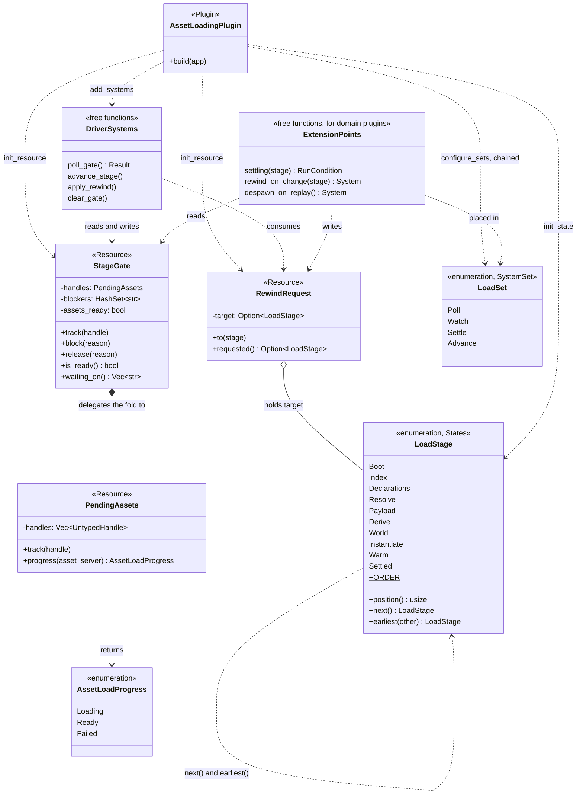

`ORDER` is a `&'static [LoadStage]` const — the single source of truth for both
"what comes next" and "is this stage earlier than that one", which is why
`next()` and `earliest()` read it rather than restating the sequence as a
`match`.

The two generic extension points lose their parameters in the box above, so in
full: `rewind_on_change::<A: Asset>(stage)` returns a system watching one asset
type, and `despawn_on_replay::<M: Component>` *is* a system, registered per
marker component rather than called.

Three things the diagram is trying to make visible:

- **`StageGate` is one resource, not one per stage.** `clear_gate` on `OnExit`
  resets it, so it only ever describes the stage *being entered*. That single
  fact is what makes replaying a stage clean, and it's why there's no
  stage-to-gate multiplicity anywhere.
- **`assets_ready` is a cache, not a source of truth.** It's recomputed once per
  frame by `poll_gate`, which exists so `settling(..)` can be a cheap
  `Fn(Res<State<LoadStage>>, Res<StageGate>) -> bool` instead of re-folding load
  state once per settle system per frame.
- **`StageGate` delegating to `PendingAssets` is draft scaffolding.** Migration
  step 1 moves `PendingAssets`'s body into `StageGate` and deletes the type. The
  composition arrow is temporary; the `handles` + `blockers` split is not.

### The state machine the enum encodes

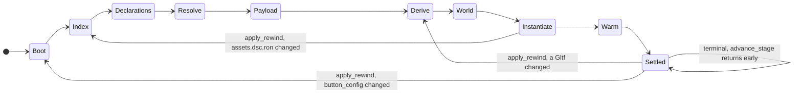

Forward edges are `advance_stage` (gate green, no blockers). Backward edges are
`apply_rewind`, and they re-walk the *same* edges a cold load walks — that's the
whole point: hot reload has no code of its own. `Settled` is terminal for forward
progress only, which is what lets `GameState::Playing` be entered once and never
left by a reload.

## 2. Object diagram — two snapshots

UML object diagrams show instances with real values. Both snapshots are the world
state during one `Update`, i.e. what `advance_stage` saw.

### Snapshot A — cold load, held at `Instantiate`

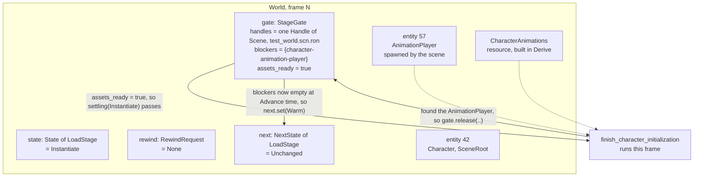

Read it as the answer to "what is the game stuck on?" — which here is a *value*
(`blockers`), printable on a loading screen via `waiting_on()`. That's the
argument for named blockers over a per-stage `ready` boolean: a boolean can't tell
you what it's waiting for, and the driver would have to learn that characters
exist in order to ask.

### Snapshot B — the frame a rewind is requested

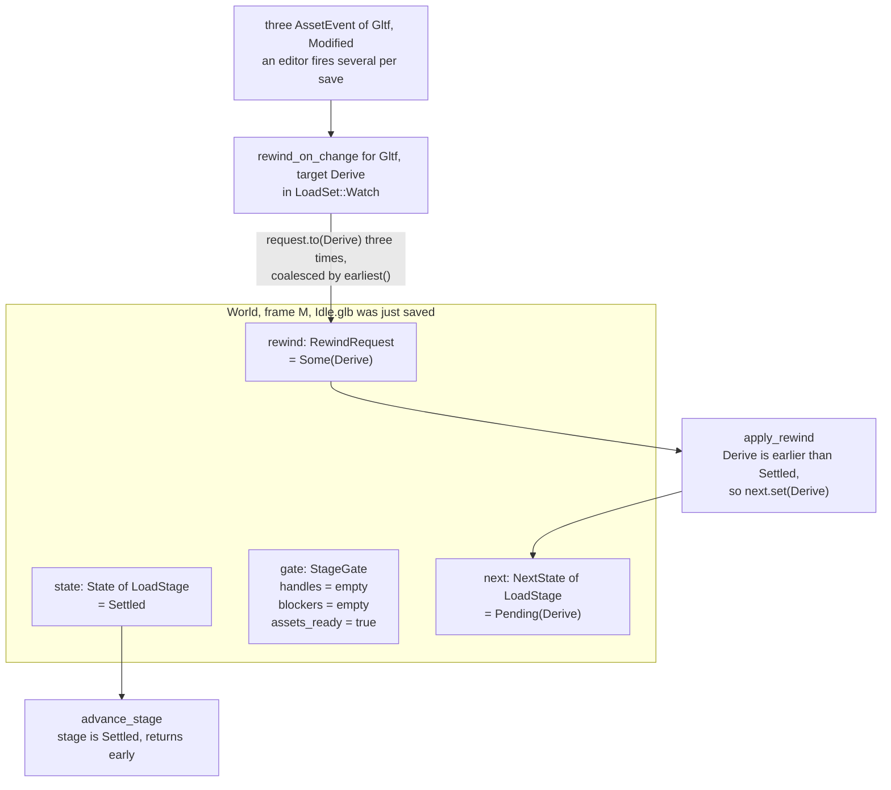

Note `handles = empty` at `Settled`: the gate was emptied by `clear_gate` on the
way out of every stage, so **the gate's strong handles only live as long as the
stage does**. Anything that must outlive its stage needs another owner — the world
scene survives because its handle is also on a `SceneRoot` component, and
`CharacterAnimations` survives because it's a resource. Worth knowing before
adding a stage that loads something nothing else holds onto.

## 3. Component diagram — who wires what

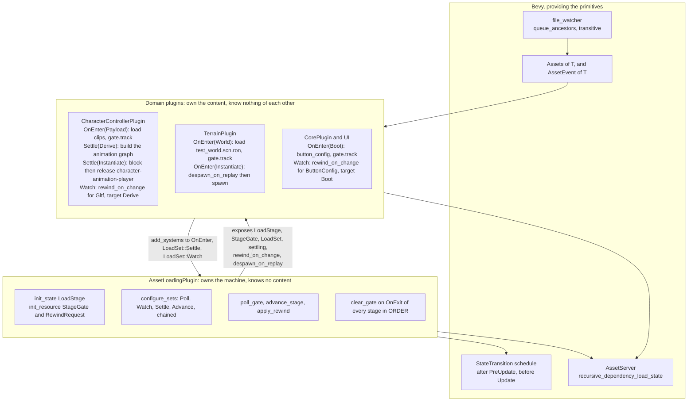

The dependency arrow worth staring at is the one that **isn't** there: nothing
goes from `Driver` to a specific domain plugin. `advance_stage` never learns that
characters or terrain exist — it compares a cached bool and a set emptiness. All
coupling runs domain → driver, through four extension points:

1. `OnEnter(stage)` — name the loads, `gate.track(..)`, `gate.block(..)`.
2. `LoadSet::Settle` + `run_if(settling(stage))` — derive, and `gate.release(..)`.
3. `LoadSet::Watch` — `rewind_on_change::<A>(consuming_stage)`.
4. `OnEnter(stage)` + `despawn_on_replay::<M>` — make a spawning stage replay-safe.

`.in_set(LoadSet::Settle)` is not decoration. It is what puts a settle system
*ahead of* `advance_stage` in the same frame, so a blocker released this frame is
seen this frame rather than next.

## 4. Sequence diagrams

### 4a. The anatomy of one frame

Everything else depends on this ordering, and most of the design's non-obvious
properties are consequences of it.

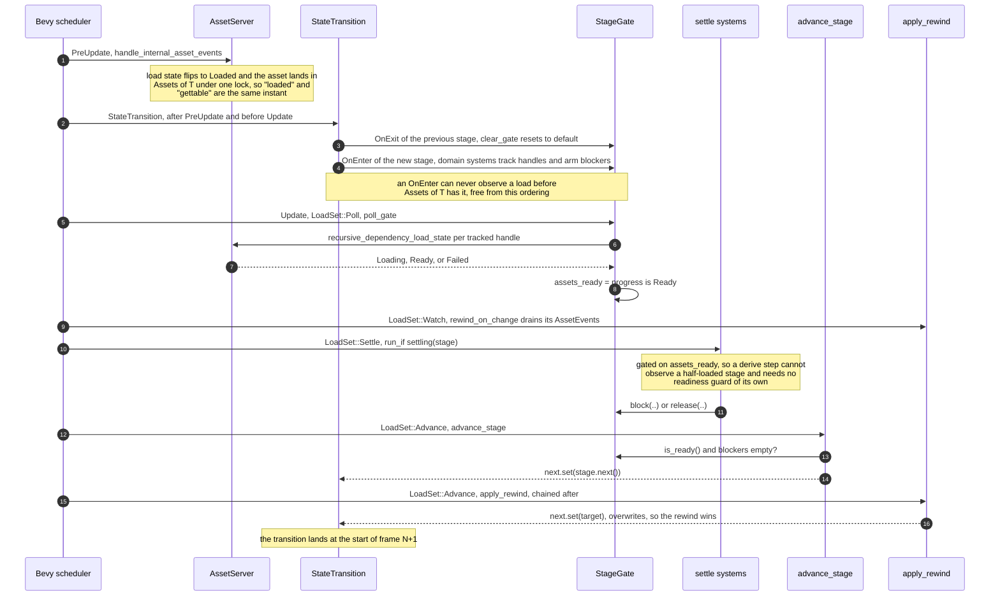

Consequences to carry into the rest of the diagrams:

- **One stage per frame, offset by one frame.** A transition asked for in frame
  N's `Update` lands at the start of frame N+1, so ten empty stages take ten
  frames.
- **The frame that lands in a stage also runs one settle call** — the `OnEnter`
  and one full `Update` both happen in it. Tests counting settle calls start at
  one, not zero.
- **Rewind beats forward progress** on a frame where both want `NextState`,
  because `(advance_stage, apply_rewind).chain()` makes the rewind the last write.
  That's the conservative direction: over-rewinding is wasteful, under-rewinding
  leaves something stale.

### 4b. Cold load — `Payload` into `Derive`

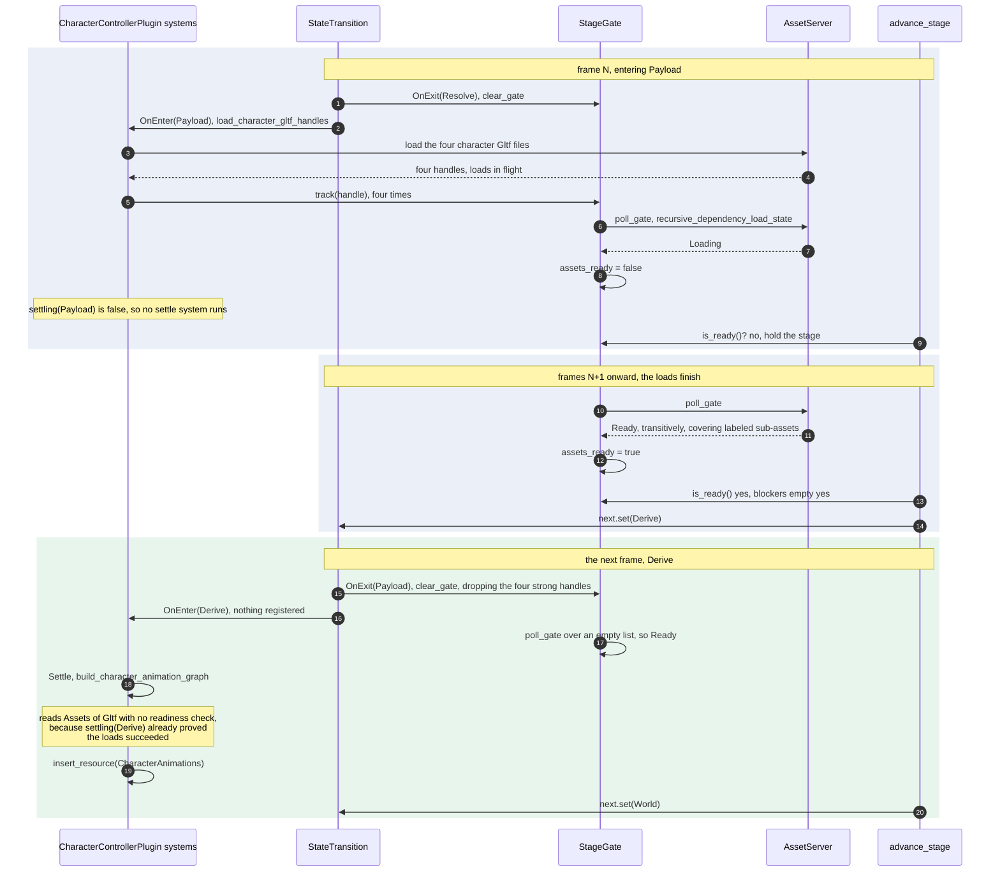

`Derive` loads nothing and still gets a stage, because *code must run between two
loads*: the `AnimationGraph` doesn't exist on disk. That is the stage-boundary
criterion from [[11 Staged Asset Loading]] §triage, and the reason the stage count
is a compile-time quantity — it's the number of derive/resolve steps you have
written in Rust.

### 4c. A blocker holding a stage open

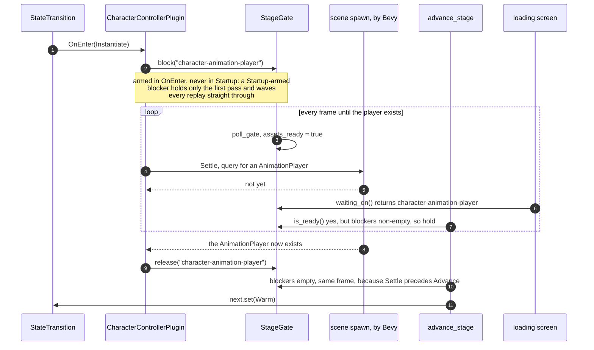

This is the generalisation of what `finish_character_initialization` does today by
early-returning and retrying: the same retry loop, except *the reason it is
waiting becomes a value* instead of an implicit early return — which is where the
loading screen's text and the "what are we stuck on?" log line come from for free.

### 4d. Hot reload — a rewind through the same path

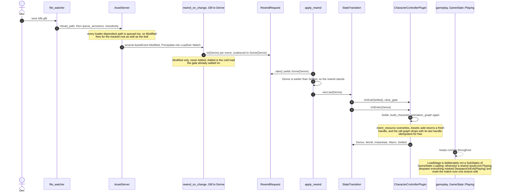

The cost of this model is re-entrancy, and it's a per-stage *discipline* rather
than a mechanism. `Instantiate` and `World` are the two stages where it isn't
free:

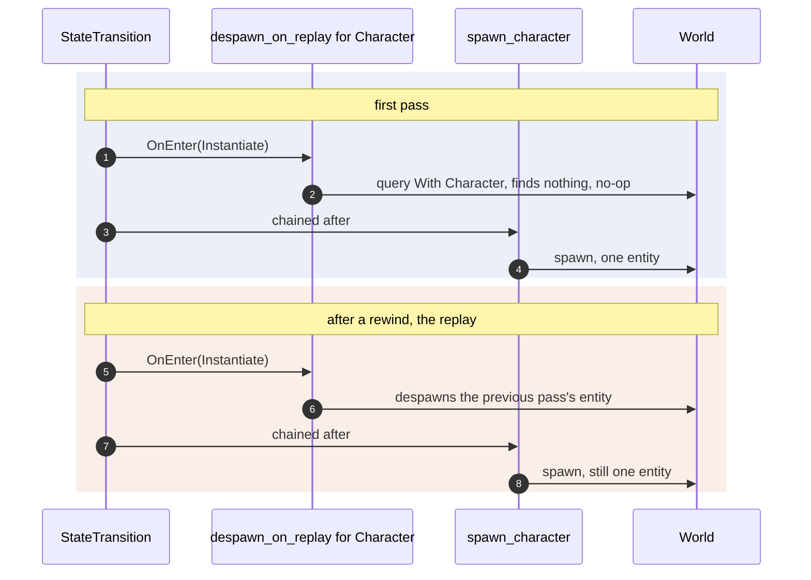

Despawn on *entry*, not `DespawnOnExit(LoadStage::Instantiate)` as the design doc
sketched: `DespawnOnExit` fires on *any* exit, including the forward one into
`Warm`, so it would despawn the character on the way into gameplay rather than on
a replay. Entry-despawn is idempotent in the direction that matters and doesn't
care how the stage was re-entered. (`DespawnOnExit` is still the right tool for
something whose lifetime really is "while this stage is current" — a progress
widget.)

### 4e. Failure

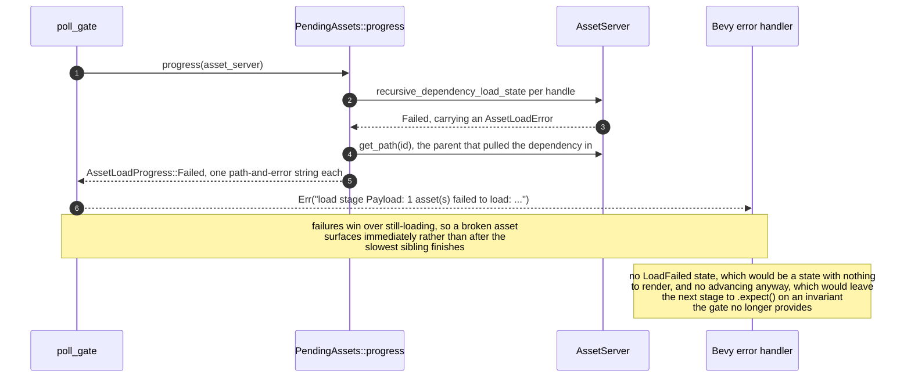

The stage name in the message is what's new relative to `check_pending_assets`:
the same failure is now attributed to the stage that asked for the load.

## Where the draft stops

Both omissions are deliberate and documented in `asset_loading/mod.rs`:

- **`OnEnter(LoadStage::Settled)` does not set `GameState::Playing` yet.** One
  line, and it's in the design, but adding it while `check_pending_assets` still
  drives `GameState` would give the app two drivers racing for the same state. It
  belongs with migration step 2, which collapses `GameState` to
  `Loading`/`Playing` and deletes `check_pending_assets` in the same change.
- **Exactly one stage has content: `Boot`.** `load_button_config`
  (`src/systems/core/button_config.rs:24`, registered at
  `src/systems/core/mod.rs:45`) loads `button_config.ron` and tracks it, so
  `Boot` genuinely holds the machine until the file is in `Assets<ButtonConfig>`.
  Every other stage is empty and passes through the frame it's entered — the
  designed behaviour for empty stages ("a stage with no registered systems tracks
  nothing and blocks nothing"), which is what lets the full stage list exist
  before every stage has content.

So the `Boot` row of §3 is real, and `boot_loads_the_real_button_config_and_then_advances`
covers it against the actual file. The `Payload`/`Derive`/`World`/`Instantiate`
rows, and therefore §4b–§4d, still show the *shape* registration will take, with
`CharacterControllerPlugin` and `TerrainPlugin` as the worked examples from the
migration plan — those three loads still run on `Startup` through `PendingAssets`
(`src/resources/character_animations.rs:59`, `src/systems/terrain/mod.rs:29`). The
driver itself — §1 through §4a — is real, and covered by the tests at the bottom
of `asset_loading/mod.rs`.

### One ordering fact worth pinning down

The initial `OnEnter(LoadStage::Boot)` runs **inside the first `app.update()`**,
in the `StateTransition` that precedes `PreStartup`
(`bevy_state-0.20.0/src/state/transitions.rs:43`) — not before the first update,
and not after `Startup`. Two consequences:

- A `Boot` load system runs *earlier* than the `Startup` system it replaces, so
  moving a load onto the stage never delays it.
- A stage system therefore cannot read anything a `Startup` system produced.
  That's why `load_button_config` has to issue the load itself rather than
  tracking a handle `Startup` created — the handle wouldn't exist yet.

## Where this fits

- ⬅ Describes: [[11 Staged Asset Loading]] (the design these diagram), §"Stage
  model", §"The transition mechanism", §"Hot reload is a backward transition"
- 🔗 Related: [[12 Asset Description]] (what flows through `Index`,
  `Declarations`, `Resolve` and `Payload`), [[15 State Management]] (the
  `GameState` machine this replaces), [[06 Assets and Scenes]] (the transitive
  dependency tracking §4b relies on)
